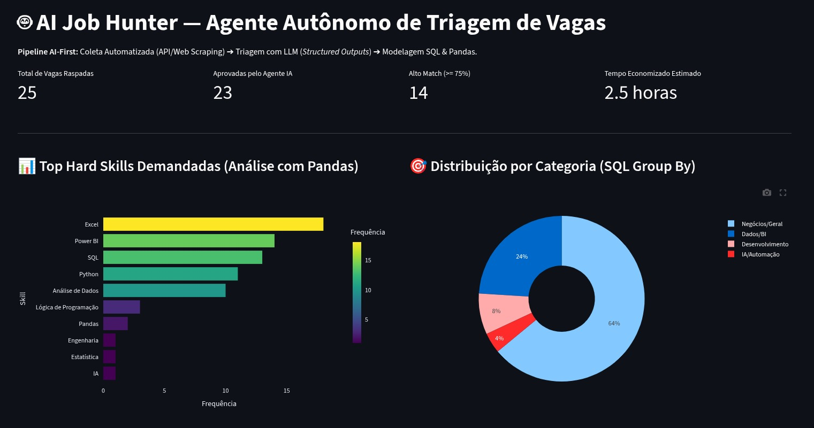
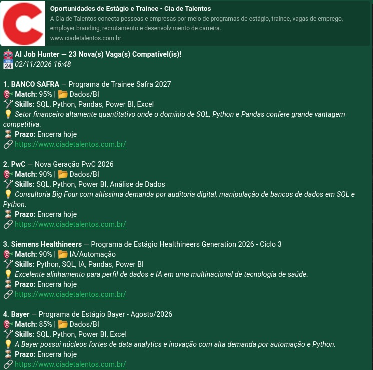
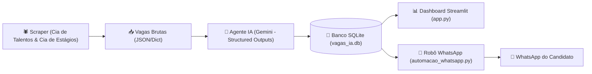

# AI Job Hunter — Web Scraper & Agente Autônomo de Triagem de Vagas

> **Pipeline AI-First de Empregabilidade:** Da raspagem de dados brutos à triagem semântica com Large Language Models (LLM), armazenamento em SQLite e notificações proativas via WhatsApp com dashboard interativo em Streamlit.

---

## Demonstração do Projeto

<div align="center">
  
  
  <p><em>Dashboard Analítico em Streamlit com métricas de compatibilidade (Match Score), gráficos em Plotly e disparo de alertas.</em></p>
</div>

<br>

<div align="center">
  
  <p><em>Alerta proativo recebido no WhatsApp contendo apenas vagas compatíveis com TI/Dados e alto Match Score.</em></p>
</div>

---

## 💡 Sobre o Projeto & Metodologia de Desenvolvimento

Este projeto une **fundamentos sólidos de Engenharia de Dados e Web Scraping** com as práticas mais modernas de **Vibe Coding e Engenharia de IA Generativa**:

### 1. Web Scraping & Manipulação de Dados (Desenvolvimento Autoral)
O arquivo base [`script.py`](./script.py) foi desenvolvido artesanalmente por mim, utilizando técnicas de:
- **Engenharia Reversa de APIs Web:** Análise de requisições em rede (Network tab) e consumo direto de endpoints REST privados (Cia de Talentos) com payloads JSON customizados.
- **Web Scraping Avançado:** Extração e parsing de conteúdo HTML na Cia de Estágios com **Scrapy (Selectors CSS/XPath)** e requisições HTTP seguras com cabeçalhos simulados.
- **Tratamento e Modelagem:** Estruturação dos dados brutos coletados para alimentar pipelines analíticas.

### 2. Automação, IA & Vibe Coding (Pair Programming com Agente de IA)
A partir do extrator inicial, a solução foi escalada utilizando **Vibe Coding** — guiando iterativamente um agente autônomo para arquitetar uma solução de ponta a ponta:
- **Triagem Semântica com LLM (Google Gemini):** Uso do modelo `gemini-3.5-flash` / `gemini-3.8-flash` com *Structured Outputs* (via Pydantic) para analisar requisitos implícitos, filtrar vagas de TI/Dados, extrair hard skills e calcular um `match_score` (0 a 100%).
- **Persistência Relacional com SQLite & Pandas:** Criação automática de tabelas relacionais (`vagas_analisadas` e `vagas_notificadas`), garantindo persistência estruturada e controle anti-spam.
- **Automação Proativa no WhatsApp:** Robô de monitoramento contínuo em background (`automacao_whatsapp.py`) integrado à **Green-API** / **Twilio Sandbox**, disparando resumos formatados no WhatsApp apenas para vagas inéditas e qualificadas.
- **Dashboard Analítico em Streamlit:** Interface visual completa com filtros por afinidade técnica, KPIs de tempo economizado, gráficos interativos em Plotly e botão de disparo manual.

---

## 🏗️ Arquitetura do Sistema



---

## 🛠️ Tecnologias Utilizadas

- **Linguagem:** Python 3.12
- **Coleta de Dados:** `Requests`, `Scrapy (Selector)`, `Jina AI Reader`
- **Inteligência Artificial:** `Google GenAI SDK`, `Pydantic` (Saídas estruturadas com Tipagem Rígida)
- **Manipulação & Armazenamento:** `Pandas`, `SQLite3`
- **Visualização & Dashboard:** `Streamlit`, `Plotly Express`
- **Mensageria & Automação:** `Green-API`, `Twilio Sandbox`, `CallMeBot`

---

## 🚀 Como Executar Localmente

### 1. Clonar o repositório e criar o ambiente virtual
```bash
git clone https://github.com/SEU_USUARIO/Web_Scraper_de_Vagas.git
cd Web_Scraper_de_Vagas

python3 -m venv venv
source venv/bin/activate  # No Linux/Mac
# venv\Scripts\activate   # No Windows
```

### 2. Instalar as dependências
```bash
pip install -r requirements.txt  # ou instale pandas requests scrapy streamlit plotly google-genai pydantic
```

### 3. Configurar as variáveis de ambiente
Copie o arquivo de exemplo e preencha com as suas credenciais:
```bash
cp .env.example .env
```
Edite o arquivo `.env`:
```ini
GEMINI_API_KEY=sua_chave_do_google_ai_studio
WHATSAPP_PHONE=5527999999999
GREEN_API_INSTANCE_ID=seu_instance_id
GREEN_API_TOKEN=seu_token_aqui
SCORE_MINIMO_WHATSAPP=60
INTERVALO_HORAS=4
```

### 4. Executar a Pipeline de IA
```bash
python pipeline_ia.py
```

### 5. Iniciar o Dashboard Streamlit
```bash
streamlit run app.py
```

### 6. (Opcional) Deixar o Monitoramento Contínuo Rodando
```bash
python automacao_whatsapp.py --horas 4
```

---

## 📂 Estrutura de Pastas

```text
├── assets/                  # Prints e demonstrações visuais para o README
├── app.py                   # Dashboard interativo com Streamlit e Plotly
├── pipeline_ia.py           # Pipeline completa: Coleta + Gemini + SQLite + WhatsApp
├── automacao_whatsapp.py    # Daemon de monitoramento recorrente
├── script.py                # Script original de web scraping autoral
├── .env.example             # Modelo das variáveis de ambiente (sem segredos)
├── .gitignore               # Proteção de credenciais (.env), venv e banco de dados
└── README.md                # Documentação técnica do projeto
```

---

## 👨‍💻 Autor

Desenvolvido por **João Victor Tobias**  
- LinkedIn: [Joao Vitor Tobias Mariani](https://www.linkedin.com/in/jo%C3%A3o-vitor-tobias-mariani-ba320a374/)  
- GitHub: [@joaovtobias](https://github.com/joaovtobias)

